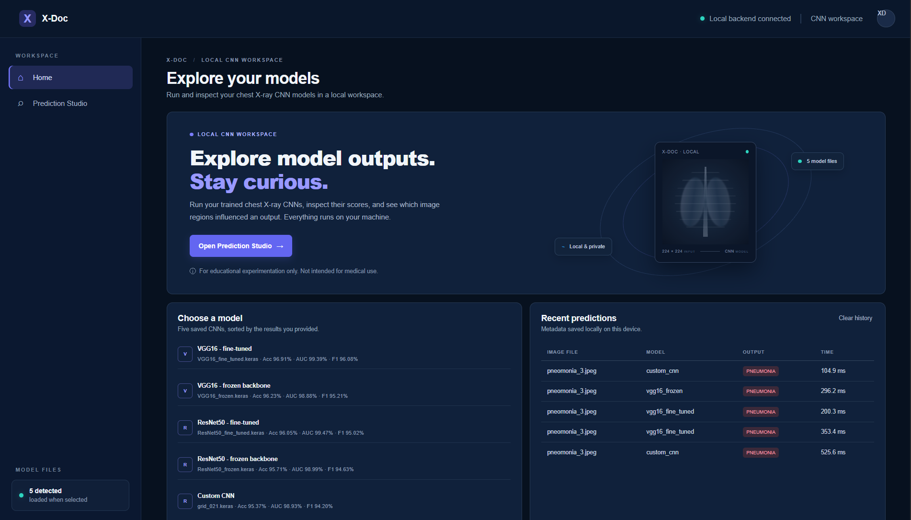
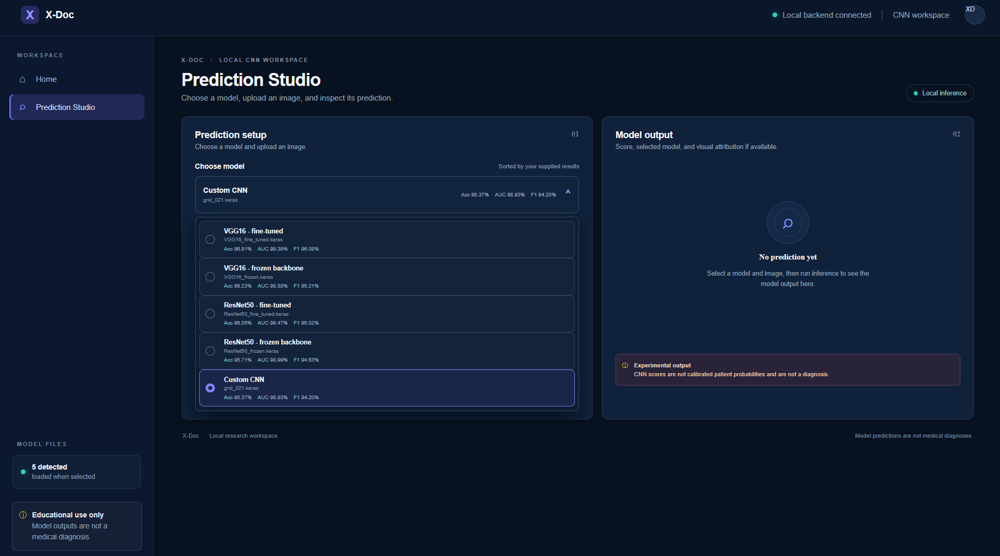
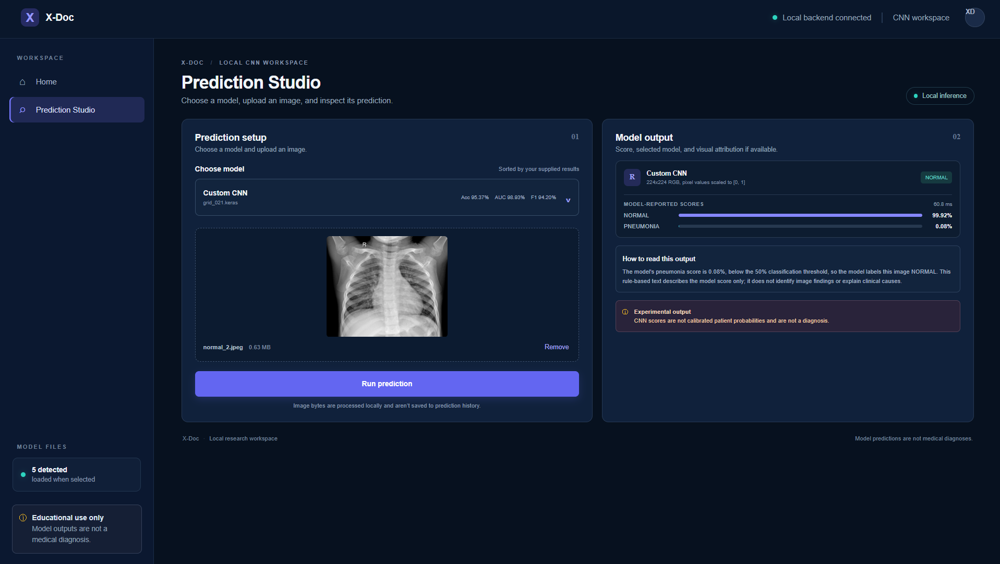
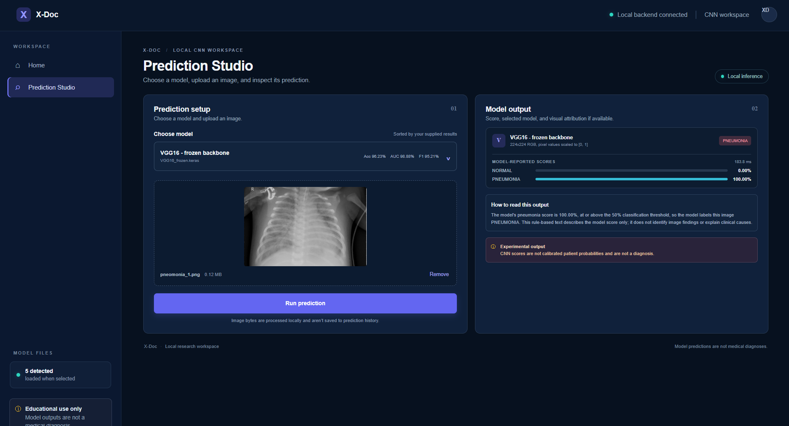
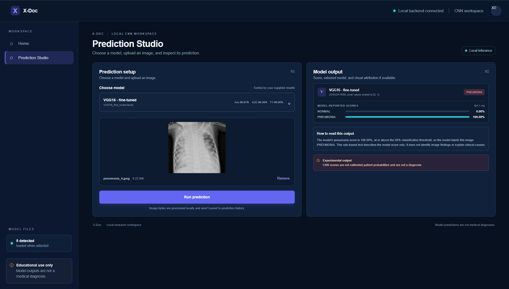
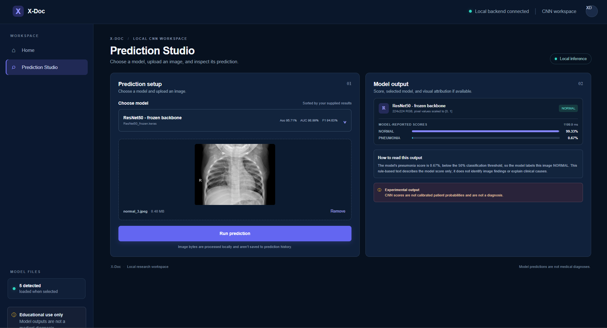
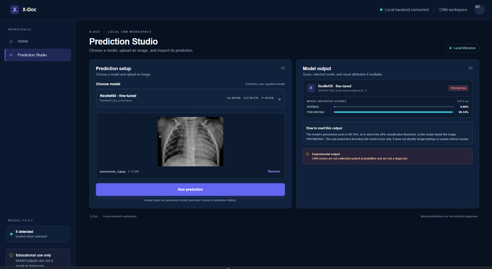

# X-Doc

[](LICENSE)

X-Doc is a local React + FastAPI app for running the supplied chest X-ray CNN models. It shows model scores and a short rule-based explanation of the predicted label. It is an educational tool, not a diagnostic product.

## Screenshots

### Dashboard



### Model selection



### Custom CNN

<table>
  <tr>
    <td align="center"><strong>Pneumonia model output</strong></td>
    <td align="center"><strong>Normal model output</strong></td>
  </tr>
  <tr>
    <td></td>
    <td></td>
  </tr>
</table>

### VGG16

<table>
  <tr>
    <td align="center"><strong>Frozen backbone</strong></td>
    <td align="center"><strong>Fine-tuned</strong></td>
  </tr>
  <tr>
    <td></td>
    <td></td>
  </tr>
</table>

### ResNet50

<table>
  <tr>
    <td align="center"><strong>Frozen backbone</strong></td>
    <td align="center"><strong>Fine-tuned</strong></td>
  </tr>
  <tr>
    <td></td>
    <td></td>
  </tr>
</table>

## Run locally

From the project root in PowerShell, start the backend:

```powershell
cd backend
.\.venv\Scripts\Activate.ps1
uvicorn app.main:app --reload --host 127.0.0.1 --port 8000
```

If the environment does not exist yet:

```powershell
cd backend
python -m venv .venv
.\.venv\Scripts\Activate.ps1
python -m pip install -r requirements.txt
```

In another terminal, start the frontend:

```powershell
cd frontend
npm install
npm run dev
```

Open the Vite URL, normally `http://127.0.0.1:5173`. FastAPI docs are at `http://127.0.0.1:8000/docs`.

## Models and supplied metrics

The picker order is VGG16 fine-tuned, VGG16 frozen, ResNet50 fine-tuned, ResNet50 frozen, and Custom CNN. It displays the supplied Accuracy, ROC-AUC, and Macro F1 values.

Download the `.keras` model files from [Uzair's Chest X-Rays CNN Models repository on Hugging Face](https://huggingface.co/uzairdot/Chest-X-Rays-CNN-Models/tree/main) into the project `models/` folder. The backend loads models on demand and registers the notebook's custom Caffe preprocessing layer used by the VGG16 and ResNet50 models.

## Input and privacy

Images are resized to 224x224 RGB and scaled to [0, 1], matching the training notebook. Images are processed locally and are not saved; only prediction metadata is stored in `backend/data/chestxray_lab.db`. Use **Clear history** on Home to remove saved records.

The explanation text is generated from the CNN score and its 0.5 decision threshold. It describes the model output only; it does not explain clinical causes or present a diagnosis. Scores are not calibrated patient probabilities.

## Contributors

- Uzair Majeed
- Faez Ahmed

## License

The application source and documentation in this repository are licensed under the MIT License; see [LICENSE](LICENSE). “MIT” is the license's name and does not imply affiliation with or endorsement by the Massachusetts Institute of Technology. Model weights are downloaded separately from [Hugging Face](https://huggingface.co/uzairdot/Chest-X-Rays-CNN-Models/tree/main) and may have separate terms. Check that repository for the applicable model license before redistributing the weights.
